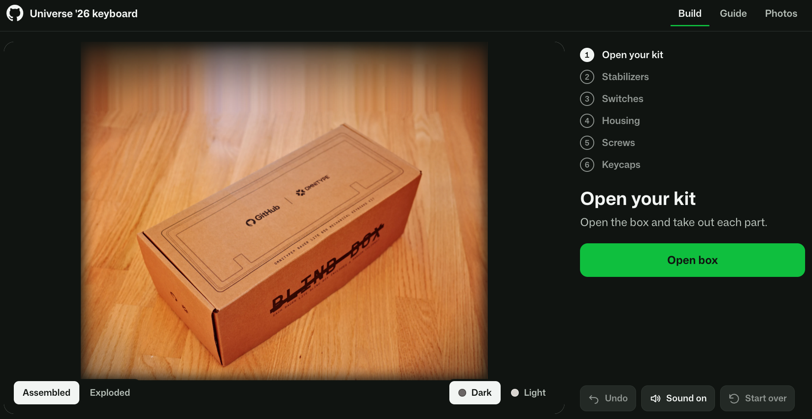
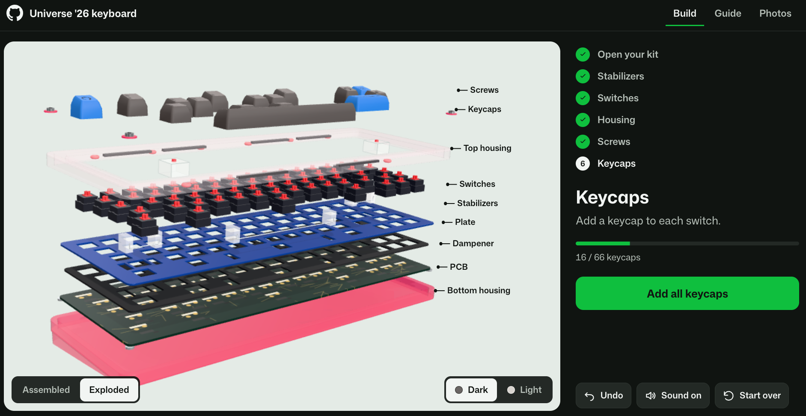
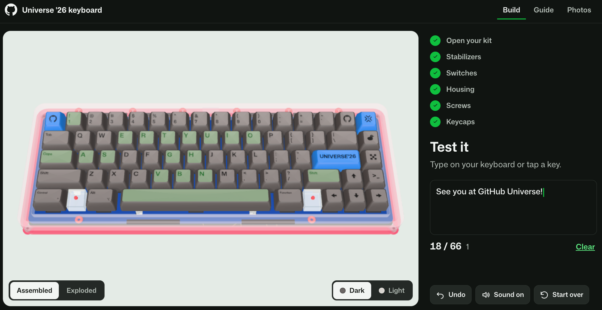

# Universe '26 keyboard

An interactive build of the GitHub Universe Omnitype Bauer Lite keyboard kit. 

## Run

```sh
npm install
npm run dev -- --port 4173
```

Open `http://127.0.0.1:4173`. 

```sh
npm test
npm run build
npm run test:e2e
```

## What it does

1. **Open your kit.** Starts from the sealed blind box. Open it, then take the parts out one at a time: housing and plate, white box, PCB, dampener and strips, stabilizers, switches, keycaps, screws. "Take out all" skips ahead.

   
2. **Assemble.** Stabilizers, dampener and plate, switches, bottom and top housing, screws, keycaps. Place parts one by one or fill the step.

   
3. **Test.** Press physical keys or tap the board. A typing preview shows what you type.

   


## Links

[Walkthrough video](https://www.youtube.com/watch?v=q3Jod8Xu8BY)

